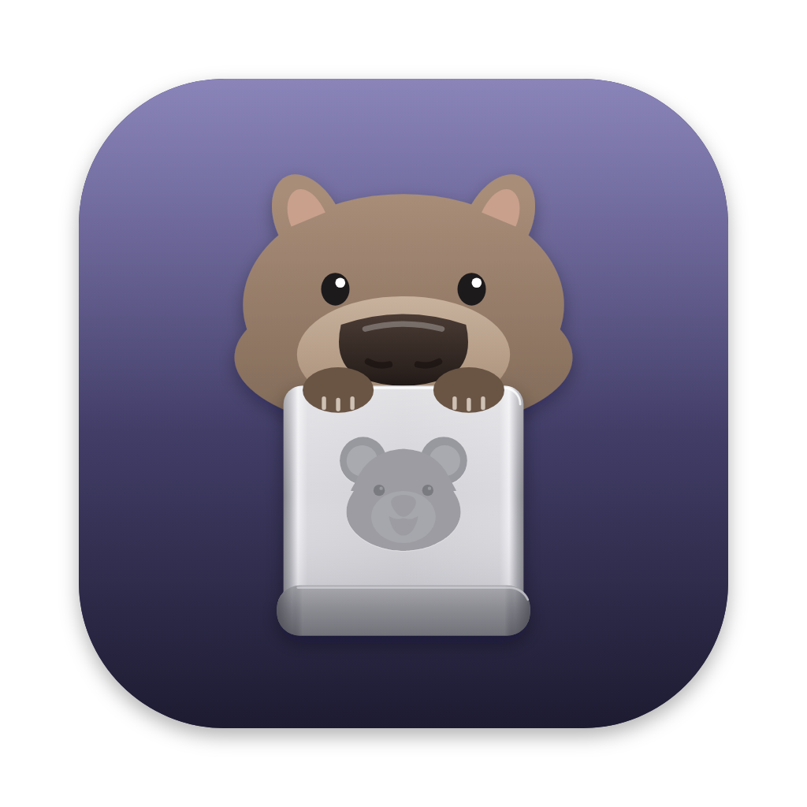

<p align="center">
  
</p>

<h1 align="center">Wombat</h1>

<p align="center">
  A small native macOS app that shows where your disk space goes and helps you free it.
</p>

<p align="center">
  <a href="https://github.com/kimiyuch/wombat.app/releases/latest/download/Wombat.dmg"><b>Download Wombat</b></a>
  ·
  <a href="https://wombat.kimiyu.ch">Website</a>
</p>

---

## Features

- Scans when you ask: a quick disk overview (home folder, ~/Library, /Applications, simulator runtimes, Homebrew), the slower search for project folders, or both
- Keeps the last scan, so the window shows it right away next time
- Usage bar of the whole disk, plus the biggest folders in your home and in ~/Library
- Cleanup list: "Safe" items (Trash, caches, npm cache, Xcode leftovers, node_modules) can be cleaned from the app; "Check first" items (Downloads, Mail, Docker, …) are yours to decide
- node_modules and Composer vendor folders: pick projects one by one
- Nothing is deleted without a confirmation

## Build

```bash
cd wombat.app
./build.sh
```

Requires macOS 14+ and Xcode (or the Command Line Tools). The finished app is in `build/Wombat.app`.

## Release

```bash
./make-dmg.sh       # build/Wombat.dmg
./release.sh 0.1    # notes from CHANGELOG.md; bumps Info.plist, tags, creates the GitHub release
```

`release.sh` needs a `## 0.1 (date)` section in `CHANGELOG.md`, a clean git tree and the GitHub CLI. It attaches `Wombat.dmg` and `CHANGELOG.md` to the release; the website reads its changelog from there.

## First run

Give Wombat **Full Disk Access** (System Settings → Privacy & Security → Full Disk Access), then reopen it. Without it, Mail, Messages and some app data look smaller than they are. Because the app is signed ad hoc, macOS may ask again after you rebuild it.

The first time you empty the Trash from Wombat, macOS asks whether it may control Finder.

## Files

- `Sources/Wombat/DiskScanner.swift` — scanning (du, find, diskutil) and the cleanup actions
- `Sources/Wombat/Views.swift` — reusable views (cards, bars, cleanup list, folder picker)
- `Sources/Wombat/WombatApp.swift` — the app and main window
- `Sources/Wombat/Theme.swift` — colours, Figtree and button styles, matching wombat.kimiyu.ch
- `Sources/Wombat/Shell.swift` — running command-line tools off the main thread
- `Resources/Fonts` — Figtree (SIL Open Font License, see `OFL.txt`)

## License

Wombat is free software under the [GNU General Public License v3](LICENSE). It bundles the Figtree font, which is
under the [SIL Open Font License](Resources/Fonts/OFL.txt).
